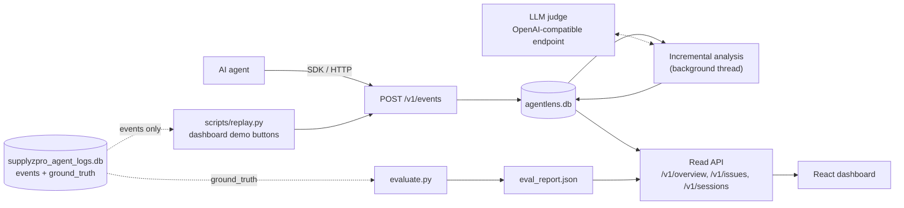

# AgentLens

AgentLens finds the AI-agent sessions that look successful but aren't. It collects agent traces,
detects hidden failures, groups them into ranked issues and shows the evidence for each verdict.

Built for the SupplyzPro "Find the Hidden Failures" hackathon, on a synthetic dataset of 120 ERP
assistant sessions.

## The problem

AI agents inside business software usually fail quietly. The tool call returns `success`, the
agent answers confidently and nothing is logged as an error, yet the user gets a wrong answer.
These are real cases from the SupplyzPro assistant logs:

| What the user sees | What actually happened | Failure type |
|---|---|---|
| "You have 11 Samsung TV 43-inch in stock." | The agent looked up the **65-inch** model and reported its stock | `wrong_record` |
| "Your order is confirmed." | `create_order` returned an error | `unsupported_success` |
| "Delivery is scheduled for tomorrow." | The tool returned `delivery_date: null` | `incomplete_request` |
| The same search three times in a row | The agent never changed its query | `no_progress` |
| "Can you give me the customer ID?" | The user had already given it | `repeated_question` |

These failures are hard to catch for three reasons:

- **Error rates and status codes miss them.** Most of these sessions have no failed tool call at all.
- **The same surface pattern means different things.** A retry after an error can be a recovery
  or a failure, and a clarifying question can be good behavior or a sign the agent is lost. What
  decides the outcome is whether the tool arguments match the request, whether the results support
  the final claim, and how the conversation ends.
- **Reading traces by hand doesn't scale,** and a list of 30 bad sessions doesn't tell a team
  which problem to fix first.

## The solution

AgentLens is an observability layer that sits next to the agent:

1. **Capture.** A small Python SDK, or a plain HTTP call, logs every user message, tool call,
   tool result and agent reply.
2. **Detect.** Deterministic rules compare the user's request, the tool arguments, the tool
   results and the agent's final claim. Each session gets an outcome (`success`, `recovered`,
   `failed` or `ambiguous`), a subtype, a confidence score, a reason, and the exact event IDs that
   prove it.
3. **Get a second opinion.** An optional LLM judge, reachable at any OpenAI-compatible endpoint,
   reviews sessions. In `hybrid` mode it only sees sessions the rules are unsure about, which keeps
   cost low. Verdicts are cached by trace hash.
4. **Analyze incrementally.** Every session's trace is hashed, so a run only re-analyzes sessions
   that are new or changed. In the demo, the second run analyzes 10 sessions and skips the other 110.
5. **Prioritize.** Failures are embedded with MiniLM, clustered into issues, and ranked by
   `priority = 100 · √(sessions / max_sessions) · severity · confidence`.
6. **Explain.** The dashboard shows the outcome breakdown and the ranked issues. For each session,
   it shows a trace view that highlights the value the agent got wrong.

**Results.** Against the dataset's hidden labels, rules-only mode gets 100% outcome accuracy,
100% macro F1 and 100% subtype accuracy. The evidence event IDs overlap the labeled evidence with
a Jaccard score of 0.79. The data is synthetic, so a perfect score shows that the pipeline works
end to end, not that it generalizes. The rules check structure (arguments against the user's
words, results against claims, how a session ends) rather than matching phrases.

## Run it locally

**Prerequisites:** Python 3.10+, Node.js 20.19+ (or 22.12+) and npm. The first analysis run downloads the
MiniLM embedding model (about 90 MB) once.

### 1. Install the backend

```bash
python3 -m venv .venv
.venv/bin/pip install torch --index-url https://download.pytorch.org/whl/cpu   # CPU-only PyTorch
.venv/bin/pip install -r requirements.txt
```

### 2. Configure the LLM judge (optional)

AgentLens runs in rules-only mode out of the box. To add the judge, copy the example config and
fill it in. The `.env` file in the project root is loaded automatically.

```bash
cp .env.example .env
.venv/bin/python -m agentlens.judge --check      # checks the endpoint and key, and lists model ids
```

| Variable | Default | Meaning |
|---|---|---|
| `AGENTLENS_LLM_BASE_URL` | empty | OpenAI-compatible endpoint ending in `/v1` (for example vLLM or NIM on Brev, Ollama, or build.nvidia.com) |
| `AGENTLENS_LLM_MODEL` | empty | Model id exposed by that endpoint |
| `AGENTLENS_LLM_API_KEY` | `EMPTY` | Sent as a bearer token |
| `AGENTLENS_MODE` | `hybrid` if the judge is configured, otherwise `rules` | `rules`, `hybrid` (judge only uncertain sessions) or `llm` (judge every session). Falls back to `rules` when the judge isn't configured. |
| `AGENTLENS_JUDGE_CONCURRENCY` | `4` | Parallel judge requests |
| `AGENTLENS_DB` | `./agentlens.db` | Path of the AgentLens database |

### 3. Start the API

```bash
.venv/bin/uvicorn agentlens.api:app --port 8100
```

The API listens on port 8100 because another app uses port 8000 on the development machine.
Interactive API docs are at http://localhost:8100/docs.

### 4. Start the dashboard

```bash
cd dashboard
npm install
npm run dev          # http://localhost:5173
```

The dashboard calls `http://localhost:8100` by default. You can override this with `VITE_API_URL`
in `dashboard/.env` (see `dashboard/.env.example`). If the API can't be reached, the dashboard
falls back to bundled mock data and the top bar shows **Mock data**. Set `VITE_USE_MOCK=1` to
always use mock data.

### 5. Run the demo

On the dashboard's Overview page, use the buttons in order:

1. **Send wave 1**: 818 events across 120 sessions, with the last two events of 10 sessions held back
2. **Run analysis**: every session is analyzed
3. **Send wave 2**: the 20 held-back events arrive, so those 10 sessions change
4. **Run analysis** again: only the 10 changed sessions are analyzed, and the other 110 are skipped

Analysis runs in the background with a live progress bar. **Reset demo** clears traces and
results but keeps the cached LLM verdicts, so rehearsals are fast. Don't delete `agentlens.db`,
because that throws the cache away.

The same flow from a terminal, plus the evaluation:

```bash
.venv/bin/python scripts/replay.py --wave 1 --analyze    # progress is printed; Ctrl+C is safe
.venv/bin/python scripts/replay.py --wave 2 --analyze    # 10 analyzed, 110 skipped
.venv/bin/python evaluate.py --show-errors               # scores vs. ground truth → eval_report.json
.venv/bin/python -m agentlens.judge S008                 # run the LLM judge on one session
```

`evaluate.py` scores every available mode (`rules`, plus `llm` and `hybrid` once the judge is
configured) and writes `eval_report.json`. The Evaluation section of the dashboard displays
that file.

### Log your own agent

```python
from agentlens.sdk import AgentLensClient

client = AgentLensClient("http://localhost:8100")
client.log_user("S001", "How many Samsung TVs do we have?")
client.log_tool_call("S001", "get_stock", {"product_name": "Samsung TV"})
client.log_tool_result("S001", "get_stock", {"stock_quantity": 37}, status="success", latency_ms=210)
client.log_agent("S001", "You have 37 Samsung TVs.")
client.flush()
client.analyze()     # starts a run and waits for it to finish
```

## Architecture



### Analysis pipeline

`POST /v1/analyze` starts a run in a background thread. The dashboard and the SDK poll
`GET /v1/analyze/status` for progress. Each run does the following:

1. **Skip unchanged sessions.** Each session's events are hashed (SHA-256 over the canonical
   event fields). The hash is compared with `session_snapshots`, together with an analyzer
   version that includes the mode and the judge model. If neither has changed, the session is
   skipped.
2. **Reconstruct.** Events are put in order and each tool call is paired with its result
   (`reconstruct.py`).
3. **Run the rules.** Detectors emit failure, recovery and ambiguity signals, each with a
   confidence score and evidence events (`rules.py`).
4. **Classify.** The session outcome is resolved in priority order: failure, then an incomplete
   trace, then ambiguity, then recovery, then success. The result is flagged as uncertain when the
   trace has no final agent reply, or when the final answer contains numbers that no successful
   tool result supports (`classify.py`).
5. **Judge (optional).** In `hybrid` mode the judge reviews uncertain sessions and sessions with
   confidence below 0.7; in `llm` mode it reviews every session.
   - If the judge agrees, the source becomes `hybrid` and the confidence rises.
   - If it disagrees, its verdict wins when it is more confident, and always in `llm` mode.
   - If the judge call fails, no snapshot is saved, so the next run retries that session.
6. **Write.** Each session's analysis and findings are committed as soon as they are done, so an
   interrupted run loses nothing.
7. **Group.** Findings are split by failure type, their signatures are embedded with MiniLM
   (falling back to TF-IDF if it is unavailable), clustered with agglomerative clustering (cosine
   distance threshold 0.3), and ranked into issues (`grouping.py`).

### Components

| Path | Role |
|---|---|
| `agentlens/sdk.py` | Client that buffers events, posts them to `/v1/events` in batches, and can start and wait for an analysis run |
| `agentlens/api.py` | FastAPI app: ingestion, background analysis job, read endpoints, demo controls |
| `agentlens/store.py` | SQLite schema and helpers for `agentlens.db` |
| `agentlens/pipeline.py` | Incremental run: hash, rules, classify, judge, write, group |
| `agentlens/snapshot.py` | Trace hash and analyzer version stored per session |
| `agentlens/reconstruct.py` | Builds one ordered session and pairs each tool call with its result |
| `agentlens/rules.py` | Detects `no_progress`, `unsupported_success`, `wrong_record`, `incomplete_request`, `repeated_question`, ambiguous endings, retries, search refinement and clarification rounds |
| `agentlens/classify.py` | Turns rule signals into one outcome and flags uncertain cases |
| `agentlens/judge.py` | LLM judge with a structured JSON verdict, cached by trace hash, prompt version and model |
| `agentlens/grouping.py` | Embeds, clusters and ranks findings into issues |
| `agentlens/demo.py` | Splits the dataset's events into two arrival waves for the demo |
| `scripts/replay.py` | Replays the waves through the SDK from a terminal |
| `evaluate.py` | Scores AgentLens against the hidden labels; the only code that reads `ground_truth` |
| `generate_dataset.py` | Regenerates the synthetic dataset (deterministic, seed 42) |
| `dashboard/` | React 19, Vite and Tailwind CSS 4 frontend |

### API

| Method and path | Purpose |
|---|---|
| `POST /v1/events` | Ingest a batch of events (`session_id`, `sequence_number`, `timestamp`, `event_type` are required). Duplicate `event_id`s are ignored. |
| `POST /v1/analyze` | Start an incremental analysis run in the background |
| `GET /v1/analyze/status` | Progress of the current run: phase, done/total, skipped, judge calls, last run summary |
| `GET /v1/overview` | Totals, outcome counts, last run, and the evaluation report |
| `GET /v1/issues` | Issues, highest priority first |
| `GET /v1/issues/{id}` | One issue and its affected sessions with reasons |
| `GET /v1/sessions?outcome=` | Sessions with their classified outcome, optionally filtered |
| `GET /v1/sessions/{id}` | Full trace, analysis and findings for one session |
| `GET /v1/demo/status` | Which demo waves have been sent |
| `POST /v1/demo/waves/{1\|2}` | Ingest demo wave 1 or 2 |
| `POST /v1/demo/reset` | Clear traces and results, keeping the LLM cache |

### Storage

`agentlens.db` is created on first use and holds these tables:

- `events`: raw trace events
- `session_snapshots`: trace hash and analyzer version per session
- `analyses`: one verdict per session
- `findings`: individual failures with details and evidence
- `issues`: grouped, ranked findings
- `llm_cache`: judge verdicts
- `analysis_runs`: history of runs

It is separate from the source dataset, `supplyzpro_agent_logs.db`.

### Ground-truth isolation

The dataset contains a hidden `ground_truth` table plus `sessions.outcome` and
`sessions.metadata`. AgentLens code (`agentlens/` and `scripts/replay.py`) only reads the
`events` table. Only `evaluate.py` reads the labels, after the analyzer has produced its
verdicts, so the scores can't leak into detection.

### Dashboard

| Page | What it shows |
|---|---|
| Overview | Demo controls, outcome breakdown, last run (analyzed vs. reused from cache), evaluation scores, confusion matrix and mode comparison |
| Issues | Hidden failures grouped into issues, ranked by priority |
| Issue detail | Severity, affected sessions, confidence, tools involved, and each affected session with its reason |
| Sessions | Every session with its outcome, subtype, confidence and deciding source, filterable by outcome |
| Session detail | The detected mismatch (requested → queried → returned → claimed), the full trace with evidence events marked and wrong values highlighted, and the analysis and findings |

## Project layout

```
agentlens/                 detection engine and API
scripts/replay.py          replay the dataset through the SDK
dashboard/                 React dashboard
evaluate.py                scoring against ground truth
generate_dataset.py        synthetic dataset generator
supplyzpro_agent_logs.db   source dataset (events + hidden labels)
agentlens.db               AgentLens state (created at runtime, git-ignored)
eval_report.json           latest evaluation (git-ignored)
```

---

## SupplyzPro Agent Logs — Synthetic Dataset

A synthetic SQLite dataset of AI agent sessions for the "Find the Hidden Failures"
hackathon challenge. It simulates an ERP assistant (similar to SupplyzPro) handling
inventory checks, customer/order lookups, contact updates, order creation,
cancellations, invoices, and sales reports — including realistic **hidden**
failures, legitimate recoveries, and legitimate ambiguity.

### Files

- `generate_dataset.py` — regenerates `supplyzpro_agent_logs.db` from scratch (deterministic, seeded).
- `supplyzpro_agent_logs.db` — the SQLite database.
- `README.md` — this file.

Run the generator with:

```bash
python3 generate_dataset.py
```

It uses only the Python standard library (`sqlite3`, `json`, `random`, `itertools`,
`datetime`). Re-running it always produces the exact same database (seed = 42).

### Dataset size

- 120 sessions
- 838 events
- 32 customers, 24 products, 74 orders, 20 invoices
- Outcome distribution: 62 success / 24 recovered / 21 failed / 13 ambiguous
  (~52% / 20% / 17.5% / 10.5%)

### Schema

#### `sessions`

| column        | notes |
|---------------|-------|
| session_id    | PK, e.g. `S001` |
| started_at / ended_at | timestamps of first/last event |
| scenario_type | one of: `inventory_check`, `customer_order_lookup`, `update_customer`, `create_order`, `cancel_order`, `invoice_lookup`, `sales_report` |
| outcome       | `success` \| `recovered` \| `failed` \| `ambiguous` (same value as `ground_truth.outcome`, denormalized onto the session for convenience) |
| metadata      | JSON: `{channel, agent_version, locale, variant}` |

#### `events` — the full chronological session history

| column | notes |
|---|---|
| event_id | PK, globally unique, increases with time across the whole dataset |
| session_id | FK → sessions |
| sequence_number | 1-based position within the session |
| timestamp | `YYYY-MM-DD HH:MM:SS`, strictly increasing within a session |
| event_type | `user_message` \| `agent_message` \| `tool_call` \| `tool_result` |
| role | `user` \| `assistant` \| `tool` |
| content | short human-readable text for the event |
| tool_name | set on `tool_call`/`tool_result` events only |
| tool_arguments_json | JSON text, set on `tool_call` events |
| tool_result_json | JSON text, set on `tool_result` events |
| tool_status | `success` \| `error`, set on `tool_result` events only |
| latency_ms | set on `tool_result` events only |

A session is always a `tool_call` immediately followed by its `tool_result` (never
detached), and `user_message`/`agent_message` events carry the conversational turns
around them.

#### `customers`

32 synthetic customers. Deliberately includes **duplicate/shared names** so
ambiguity arises naturally:
- 4 customers named "Ahmed ..." (Ben Ali/Tunis, Ben Salah/Sfax, Trabelsi/Sousse, Gharbi/Tunis)
- 2 "Mohamed Karray" (Tunis, Sfax)
- 2 "Sana Jlassi" (Tunis, Bizerte)
- 24 other customers with unique names

`customers.phone` reflects the **true current state** — i.e. if an agent's
`update_customer` call actually succeeded, the phone here is updated; if the
agent merely *claimed* success while the tool errored, the phone here is
unchanged. This is one of the cross-referencing signals for detecting
`unsupported_success`.

#### `products`

24 products across Electronics/Computers/Appliances/Office/Accessories, with
`stock_quantity`. Several products are intentionally similar/confusable
(e.g. "Samsung TV 55-inch" vs "LG TV 55-inch", "iPhone 14" vs "iPhone 13"),
enabling the `wrong_record` failure type.

#### `orders`

74 orders: most are pre-existing "baseline" ERP history (created before any
session), plus new orders created during `create_order` sessions. `status`
includes `pending_scheduling` for orders where a `create_order` tool call
technically succeeded but delivery was never actually scheduled
(`delivery_date IS NULL`) — the ground truth for that scenario.

#### `invoices`

20 invoices tied to a subset of shipped/delivered orders, with `amount`,
`issued_date`, `paid_status`.

#### `tool_definitions`

The 8 tools available to the agent: `find_customer`, `get_stock`, `find_order`,
`get_invoice`, `create_order`, `update_order`, `update_customer`,
`get_sales_report`. Each row has a `description` and a `parameters_json`
sketch of its arguments.

#### `ground_truth` — hidden evaluation table

**Do not have your analyzer read this table.** It exists only so you can score
your own detector afterwards.

| column | notes |
|---|---|
| ground_truth_id | PK |
| session_id | FK → sessions (1 row per session) |
| outcome | `success` \| `recovered` \| `failed` \| `ambiguous` |
| failure_type | set only when `outcome = failed`: `unsupported_success` \| `repeated_question` \| `no_progress` \| `wrong_record` \| `incomplete_request` |
| recovery_type | set only when `outcome = recovered`: `retry_success` \| `search_refinement` \| `clarification_success` \| `corrected_tool_arguments` |
| ambiguity_type | set only when `outcome = ambiguous`: `multiple_customers` \| `multiple_orders` \| `missing_information` \| `unclear_user_intent` |
| severity | `low` \| `medium` \| `high`, set on failures |
| explanation | one-paragraph human explanation of the classification |
| evidence_event_ids | JSON array of the exact `event_id`s that justify the label |

No event or session row is tagged with an explicit `is_failure` flag — the
labels only exist in `ground_truth`, and the surface-level dialogue for a given
failure/recovery/ambiguity type intentionally overlaps with other outcomes for
the same scenario family (e.g. a retry pattern appears under both `recovered`
and `failed`; a "which Ahmed do you mean?" clarifying question appears under
both `ambiguous` and `success`/`recovered`). The distinguishing signal is always
in the actual tool arguments/results and how the conversation resolves, not in
any label baked into the event content.

### Scenario types (event_type patterns) and what they represent

- **`inventory_check`** — stock questions via `get_stock`. Includes clean
  success, a transient-DB-error retry that recovers, a `wrong_record` case
  (agent queries a similar-but-wrong product and reports its number as if it
  were the requested product), and an `unsupported_success` case (two failed
  lookups, agent invents a number anyway).
- **`customer_order_lookup`** — `find_customer` + `find_order` on ambiguous
  names ("Ahmed", "Mohamed Karray", "Sana Jlassi"). Covers: unique match,
  clarify-and-resolve (success), agent self-refines using context already in
  the message (`search_refinement`, recovered), two-round clarification
  (`clarification_success`, recovered), clarification with no reply
  (`multiple_customers`, ambiguous), repeating the identical ambiguous search
  3x with no refinement (`no_progress`, failed), and asking for info the user
  already gave (`repeated_question`, failed).
- **`update_customer`** — `update_customer` on a phone number. Covers success,
  a validation-error-then-corrected-format retry (recovered), and a write
  conflict where the agent claims success anyway (`unsupported_success`,
  failed — verifiable against `customers.phone`).
- **`create_order`** — `create_order` with a quantity/delivery date. Covers
  success, `incomplete_request` (delivery_date comes back `null` but the agent
  promises "tomorrow" anyway — verifiable against `orders.delivery_date`),
  a stock-limit error that the agent transparently negotiates down and retries
  (recovered/`corrected_tool_arguments`), and a transient-outage retry
  (recovered/`retry_success`).
- **`cancel_order`** — `find_order` + `update_order` to cancel. Covers a
  single-open-order success, multiple open orders with no reply
  (`multiple_orders`, ambiguous), and multiple open orders resolved by
  clarification (recovered).
- **`invoice_lookup`** — `get_invoice`. Covers success and a vague request with
  no order/customer specified (`missing_information`, ambiguous).
- **`sales_report`** — `get_sales_report`. Covers success and a vague request
  with no period/category specified (`unclear_user_intent`, ambiguous).

### Example SQL queries

**1. Reconstruct one session's full timeline**
```sql
SELECT sequence_number, timestamp, event_type, role, content, tool_name,
       tool_arguments_json, tool_result_json, tool_status
FROM events
WHERE session_id = 'S036'
ORDER BY sequence_number;
```

**2. All tool calls (with their paired results) for a session**
```sql
SELECT e1.sequence_number, e1.tool_name, e1.tool_arguments_json,
       e2.tool_result_json, e2.tool_status, e2.latency_ms
FROM events e1
JOIN events e2
  ON e2.session_id = e1.session_id
 AND e2.sequence_number = e1.sequence_number + 1
 AND e2.event_type = 'tool_result'
WHERE e1.session_id = 'S036' AND e1.event_type = 'tool_call'
ORDER BY e1.sequence_number;
```

**3. Sessions containing repeated identical tool calls (candidate no-progress patterns)**
```sql
SELECT session_id, tool_name, tool_arguments_json, COUNT(*) AS n
FROM events
WHERE event_type = 'tool_call'
GROUP BY session_id, tool_name, tool_arguments_json
HAVING COUNT(*) >= 2
ORDER BY n DESC;
```

**4. Count sessions by scenario type and outcome**
```sql
SELECT scenario_type, outcome, COUNT(*)
FROM sessions
GROUP BY scenario_type, outcome
ORDER BY scenario_type, outcome;
```

**5. All sessions with at least one tool error**
```sql
SELECT DISTINCT session_id, tool_name
FROM events
WHERE event_type = 'tool_result' AND tool_status = 'error';
```

**6. Join a `find_customer` tool result with the real customers table**
```sql
SELECT e.session_id, e.tool_arguments_json, c.customer_id, c.name, c.city, c.phone
FROM events e
JOIN customers c
  ON json_extract(e.tool_arguments_json, '$.query') = c.name
WHERE e.tool_name = 'find_customer' AND e.event_type = 'tool_call';
```

**7. Cross-check `update_customer` claims against the real customers table**
```sql
SELECT s.session_id, e.tool_arguments_json AS attempted_update,
       c.phone AS actual_current_phone
FROM sessions s
JOIN events e ON e.session_id = s.session_id AND e.tool_name = 'update_customer'
              AND e.event_type = 'tool_call'
JOIN customers c ON c.customer_id = json_extract(e.tool_arguments_json, '$.customer_id')
WHERE s.scenario_type = 'update_customer';
```

**8. Orders created with a delivery date that was never actually scheduled**
```sql
SELECT order_id, customer_id, product_id, status, delivery_date, created_at
FROM orders
WHERE delivery_date IS NULL;
```

**9. Full ground truth for one session, with its evidence events expanded**
```sql
SELECT * FROM ground_truth WHERE session_id = 'S036';
-- then, using evidence_event_ids (a JSON array):
SELECT * FROM events
WHERE event_id IN (SELECT value FROM json_each(
  (SELECT evidence_event_ids FROM ground_truth WHERE session_id = 'S036')
))
ORDER BY sequence_number;
```

**10. Distribution of failure/recovery/ambiguity subtypes**
```sql
SELECT outcome, failure_type, recovery_type, ambiguity_type, COUNT(*)
FROM ground_truth
GROUP BY outcome, failure_type, recovery_type, ambiguity_type
ORDER BY outcome;
```

### Recommended queries to run before building your analyzer

1. `SELECT outcome, COUNT(*) FROM sessions GROUP BY outcome;` — confirm the
   class balance.
2. `SELECT scenario_type, outcome, COUNT(*) FROM sessions GROUP BY 1,2 ORDER BY 1,2;`
   — see which scenario families produce which outcomes, and note that the
   same family produces multiple outcomes (this is the point).
3. Pick 2–3 `session_id`s per outcome class and read their full timelines with
   query #1 above, then read their `ground_truth` row, to build intuition for
   what "hidden" looks like here.
4. `SELECT * FROM ground_truth WHERE failure_type = 'wrong_record';` then read
   those sessions — notice the tool call *itself* reports `status = 'success'`.
5. `SELECT * FROM ground_truth WHERE outcome = 'ambiguous';` — confirm these
   all end on an agent clarifying question with no reply, and are not
   flagged as failures anywhere in the event data.
6. Run query #3 above (repeated tool calls) and manually compare its output
   against `ground_truth.failure_type = 'no_progress'` and
   `ground_truth.recovery_type = 'search_refinement'` sessions — the same
   surface signal ("same tool called twice") appears in both a failure and a
   non-failure, so a naive "count repeated calls" rule will misclassify some
   of them. That's intentional.
7. `SELECT * FROM orders WHERE delivery_date IS NULL;` then trace each
   `order_id` back to its session via
   `json_extract(tool_result_json,'$.order_id')` to see the corresponding
   `incomplete_request` session.

### Notes on design

- Every hidden failure is technically a "successful" tool call
  (`tool_status = 'success'`) except for `unsupported_success`, where the tool
  genuinely errored but the agent's final message claims otherwise — the
  point in both cases is that `tool_status` alone is not sufficient to judge
  the session; you need to compare the user's actual request, the tool
  arguments, the tool result, and the agent's final claim, and where
  relevant, the true state in `customers`/`orders`/`invoices`.
- Retries look identical at the surface (`tool_call` → `error` →
  `tool_call` → ...) whether they end in `recovered` or `failed` — what
  differs is whether the retry actually succeeded and whether the agent's
  final message matches that outcome.
- Clarifying questions on ambiguous names look identical whether the outcome
  is `success` (user answers, resolved), `recovered` (multiple rounds needed),
  or `ambiguous` (user never answers) — what differs is purely how the
  conversation ends.
