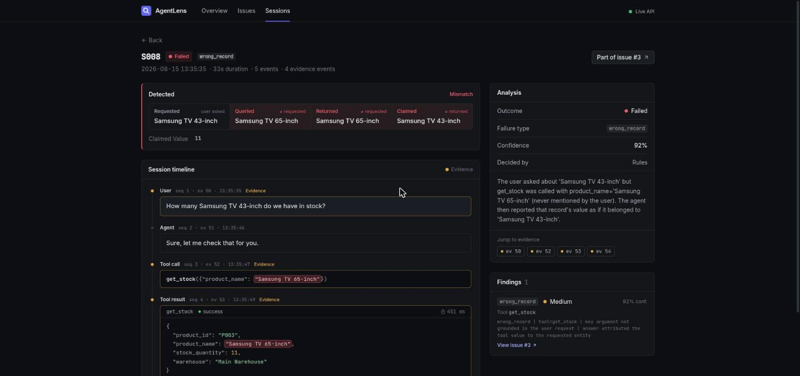
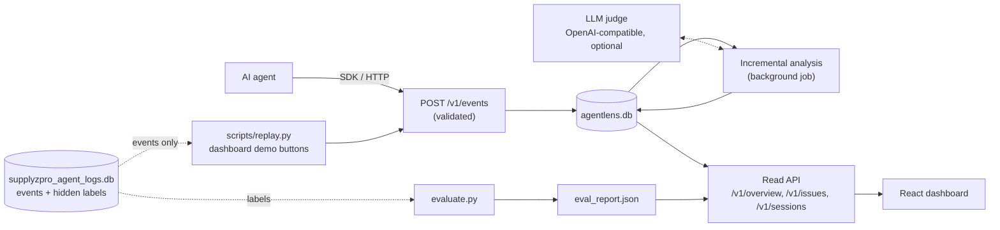

# AgentLens

AI agents inside business software usually fail quietly: the tool call returns `success`, the agent
answers confidently, nothing is logged as an error, and the user still gets a wrong answer.
AgentLens is an observability layer for teams running such agents. It ingests agent traces, checks
each session's final claim against what the tools actually returned, labels the session
(`success`, `recovered`, `failed` or `ambiguous`), groups the failures into ranked issues, and
shows the exact events that prove each verdict. It was built for the SupplyzPro "Find the Hidden
Failures" hackathon and is scored by an evaluator against labels the detector never sees.



*Session S008. The user asked for the Samsung TV 43-inch, the agent queried the 65-inch model, the
tool call succeeded, and the agent reported that number as the 43-inch stock. No error was logged
anywhere.*

More screens: [the Overview after an incremental run](docs/img/overview-incremental-run.jpg) and
[the ranked issues](docs/img/issues-ranked.jpg).

## Key features

- **Hidden-failure detection.** Deterministic rules compare the user's request, the tool arguments,
  the tool results and the agent's final claim. They detect five failure types (`wrong_record`,
  `unsupported_success`, `incomplete_request`, `no_progress`, `repeated_question`) and tell them
  apart from legitimate recoveries and from genuinely ambiguous requests.
- **Evidence for every verdict.** Each session gets an outcome, a subtype, a confidence, a reason
  in plain language and the event IDs that justify it. The dashboard highlights the mismatching
  values in the trace.
- **Incremental analysis.** Every session's trace is hashed, so a run only re-analyzes sessions
  that are new or changed. In the bundled demo the second run analyzes 10 sessions and skips 110.
- **Ranked issues.** Failures are grouped into issues and ranked by
  `priority = 100 · √(sessions / max_sessions) · severity · confidence`.
- **Optional LLM judge.** Any OpenAI-compatible endpoint can review the sessions the rules are
  unsure about (`hybrid`) or every session (`llm`). Verdicts are cached by trace hash.
- **Scored against hidden labels.** `evaluate.py` is the only code that reads the labels. CI fails
  if the score drops below a threshold.

## Results

Every number below was produced by `evaluate.py` in rules-only mode. The LLM judge modes have not
been measured for this README.

| Dataset | Sessions | Accuracy | Macro F1 | Failure recall | Failure precision | Subtype accuracy |
| --- | --- | --- | --- | --- | --- | --- |
| Committed dataset (seed 42) | 120 | 100% | 100% | 100% | 100% | 100% |
| Held-out seeds (1, 7, 123, 2026, 99999) | 120 each | 100% | 100% | 100% | 100% | 100% |
| Out-of-template set (`data/out_of_template_sessions.json`) | 16 | 75.0% | 80.3% | 33.3% | 100% | 85.7% |

How to read this:

- The rules were written against the committed dataset, so 100% there shows that the pipeline
  works end to end. It is not evidence of generalization.
- A held-out seed changes the customers, products, quantities and timestamps, but uses the same
  scenario templates and phrasing. It shows the rules do not depend on specific values.
- The out-of-template set is 16 hand-written sessions from a different domain (a SaaS support
  desk) with different tools and wording. Its labels were written before the rules were run on it
  and the rules have not been tuned against it. There the rules never raise a false alarm, but
  they miss 4 of 6 failures: a claim phrased as "All set", a re-asked email address, a wrong
  record identified by an account slug, and a transposed number.
- On the committed dataset the evidence event IDs overlap the labeled evidence with a Jaccard
  score of 0.79.

## Architecture



One analysis run does the following:

1. **Skip unchanged sessions.** A SHA-256 over each session's events is compared with the stored
   snapshot and the analyzer version (which includes the mode and judge model).
2. **Reconstruct.** Events are ordered and each tool call is paired with its result.
3. **Run the rules.** Detectors emit failure, recovery and ambiguity signals with evidence.
4. **Classify.** One outcome per session, in priority order: failure, incomplete trace,
   ambiguity, recovery, success. A session is marked uncertain when it has no final agent reply or
   when the final answer contains numbers no successful tool result supports.
5. **Judge (optional).** In `hybrid` mode the judge reviews uncertain sessions and those with
   confidence below 0.7. If a judge call fails, the session is retried on the next run.
6. **Write.** Each session is committed as soon as it is done, so an interrupted run loses nothing.
7. **Group.** Findings are split by failure type, embedded with MiniLM (TF-IDF if it is
   unavailable), clustered, and ranked into issues.

| Path | Role |
| --- | --- |
| `agentlens/api.py` | FastAPI app: validated ingestion, analysis job, read endpoints, demo controls |
| `agentlens/job.py` | The single background analysis run and its progress |
| `agentlens/pipeline.py` | Incremental run: hash, rules, classify, judge, write, group |
| `agentlens/rules.py`, `classify.py` | Detectors, and how their signals become one outcome |
| `agentlens/reconstruct.py` | Builds one ordered session and pairs tool calls with results |
| `agentlens/snapshot.py` | Trace hash and analyzer version per session |
| `agentlens/judge.py` | LLM judge with a structured JSON verdict and a cache |
| `agentlens/grouping.py` | Embeds, clusters and ranks findings into issues |
| `agentlens/taxonomy.py` | Outcome and subtype names shared by all of the above |
| `agentlens/store.py` | SQLite schema and helpers for `agentlens.db` |
| `agentlens/sdk.py` | Client that buffers events, posts them in batches and can start a run |
| `agentlens/demo.py`, `scripts/replay.py` | Replay the dataset in two waves (dashboard buttons or terminal) |
| `evaluate.py` | Scores AgentLens against labels; the only code that reads them |
| `generate_dataset.py` | Regenerates the synthetic dataset |
| `dashboard/` | React 19, Vite and Tailwind CSS 4 frontend |

The interactive API reference is at <http://localhost:8100/docs> once the API is running.

## Quick start

### Option A: Docker Compose

```bash
docker compose up --build
```

Then open <http://localhost:5173>. The first build downloads CPU-only PyTorch and takes several
minutes. Both containers run as non-root users and have health checks. If a `.env` file exists in
the project root, Compose passes it to the API, which turns the LLM judge on.

### Option B: run it directly

Prerequisites: Python 3.14 (the version the pinned dependencies were tested on), Node.js 20.19+ or
22.12+, and npm.

```bash
# 1. Backend
python3 -m venv .venv
.venv/bin/pip install torch==2.15.0 --index-url https://download.pytorch.org/whl/cpu
.venv/bin/pip install -r requirements.txt
.venv/bin/uvicorn agentlens.api:app --port 8100

# 2. Dashboard, in a second terminal
cd dashboard
npm install
npm run dev          # http://localhost:5173
```

### Run the demo

On the dashboard's Overview page, use the buttons in order:

1. **Send wave 1**: 818 events across 120 sessions, with the last two events of 10 sessions held back.
2. **Run analysis**: all 120 sessions are analyzed. The first run also downloads the MiniLM
   embedding model (about 90 MB), so it takes longer than later runs.
3. **Send wave 2**: the 20 held-back events arrive, so those 10 sessions change.
4. **Run analysis** again: only the 10 changed sessions are analyzed and the other 110 are skipped.

Then open **Issues**, pick an issue, and open one of its sessions to see the evidence.

The same flow from a terminal, plus the evaluation (with Docker, prefix each command with
`docker compose exec api` and drop `.venv/bin/`):

```bash
.venv/bin/python scripts/replay.py --wave 1 --analyze
.venv/bin/python scripts/replay.py --wave 2 --analyze    # 10 analyzed, 110 skipped
.venv/bin/python evaluate.py --show-errors               # writes eval_report.json, shown on the Overview page
```

### Log your own agent

```python
from agentlens.sdk import AgentLensClient

client = AgentLensClient("http://localhost:8100")
client.log_user("S001", "How many Samsung TVs do we have?")
client.log_tool_call("S001", "get_stock", {"product_name": "Samsung TV"})
client.log_tool_result("S001", "get_stock", {"stock_quantity": 37}, status="success", latency_ms=210)
client.log_agent("S001", "You have 37 Samsung TVs.")
client.flush()
client.analyze()     # starts a run and waits for it to finish
```

## Configuration

AgentLens runs in rules-only mode with no configuration. To enable the LLM judge, copy
`.env.example` to `.env` in the project root and fill it in. Check it with
`.venv/bin/python -m agentlens.judge --check`.

| Variable | Default | Meaning |
| --- | --- | --- |
| `AGENTLENS_LLM_BASE_URL` | empty | OpenAI-compatible endpoint ending in `/v1` |
| `AGENTLENS_LLM_MODEL` | empty | Model id exposed by that endpoint |
| `AGENTLENS_LLM_API_KEY` | `EMPTY` | Sent as a bearer token |
| `AGENTLENS_MODE` | `hybrid` if the judge is configured, otherwise `rules` | `rules`, `hybrid` or `llm`. Falls back to `rules` when the judge is not configured. |
| `AGENTLENS_JUDGE_CONCURRENCY` | `4` | Parallel judge requests |
| `AGENTLENS_DB` | `./agentlens.db` | Path of the AgentLens database (created on first use) |
| `VITE_API_URL` (dashboard) | `http://localhost:8100` | API address as seen from the browser |
| `VITE_USE_MOCK` (dashboard) | `0` | `1` shows a bundled snapshot of real API responses without a backend |

If the API cannot be reached, the dashboard shows an error and an "API offline" badge. It never
substitutes mock data on its own.

## Testing

```bash
.venv/bin/pip install -r requirements-dev.txt
.venv/bin/python -m pytest -q                                                   # 32 tests
.venv/bin/python evaluate.py --mode rules --min-accuracy 0.95 --min-macro-f1 0.95
.venv/bin/python generate_dataset.py --seed 7 --out heldout.db
.venv/bin/python evaluate.py --mode rules --db heldout.db --min-accuracy 0.95
.venv/bin/python evaluate.py --mode rules --db data/out_of_template_sessions.json --show-errors
```

The tests cover:

- each detector on a hand-written trace, next to the look-alike trace it must not flag;
- the incremental run (120 analyzed, then 10 analyzed and 110 skipped, then nothing to do);
- the demo flow through the API, input validation and concurrent requests against a real server;
- dataset determinism: regenerating seed 42 must reproduce every table of the committed database;
- label isolation: verdicts must be identical when the labels are removed from the dataset.

CI (`.github/workflows/ci.yml`) runs the tests, the three evaluations with minimum scores, an
end-to-end analysis through the API, and the dashboard build.

## Design decisions and trade-offs

- **Rules first, LLM second.** Rules are free, fast, reproducible and give exact evidence. The
  cost is coverage: they only catch the patterns they were written for, as the out-of-template
  result shows. The judge exists for the sessions the rules cannot decide.
- **Labels are kept away from the detector.** AgentLens code only reads the `events` table. Only
  `evaluate.py` reads the labels, after verdicts exist, and a test enforces that verdicts do not
  change when the labels are deleted.
- **Hash-based incremental runs.** Re-analysis is driven by a content hash and an analyzer version
  instead of timestamps, so changing the mode or the judge model re-analyzes everything, and
  nothing else does.
- **SQLite and one background thread.** This keeps setup to zero and is enough for a single-node
  demo. It is not a design for many concurrent writers.
- **Embedding-based grouping.** Findings are clustered within each failure type. On this dataset
  that produces exactly one issue per failure type, which a plain group-by would also give. The
  clustering only pays off on more varied failures, and it is the reason PyTorch is a dependency.
- **The dataset is committed and regenerable.** `supplyzpro_agent_logs.db` stays in the repository
  so the demo works on a fresh clone. It is the exact output of `generate_dataset.py` for seed 42.
  See [docs/dataset.md](docs/dataset.md) for the schema and scenarios.

## Known limitations

- The rules generalize poorly outside the scenarios they were built on: 75% accuracy and 33%
  failure recall on the out-of-template set. Several detectors depend on English phrasing and on
  field names such as `count`, `matches` and `product_name`.
- The LLM judge is implemented but unmeasured here. No judge or hybrid score is claimed.
- All data is synthetic. Nothing has been validated on production agent logs.
- The API has no authentication, allows any CORS origin, and exposes a reset endpoint. Run it on
  localhost only; the Compose file publishes it on the loopback interface for that reason.
- Events logged without an `event_id` get an automatic one, which can collide with replayed
  dataset IDs. Do not mix the demo replay and your own agent's events in the same database.
- The dependency pins were tested on Python 3.14 only.

## License

No license has been chosen yet, so all rights are reserved. Ask before reusing the code.
